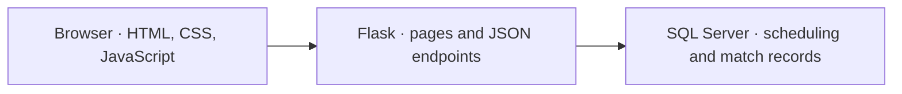

# SIGELFA Web

SIGELFA Web is an academic web application for managing amateur football leagues. It connects league and team registration, round-robin scheduling, referee reports, and match history in a single workflow. The application was built with Python, Flask, SQL Server, and vanilla JavaScript.

This public repository contains the project overview and a [fictional league dataset](examples/league.example.json). The example follows four teams through a three-round schedule and includes a completed referee report. You can explore it directly in GitHub or run the terminal walkthrough below.

[Quick start](#quick-start) · [What the application does](#what-the-application-does) · [Architecture](#architecture) · [My contributions](#my-contributions)

## Quick start

Install [Git](https://git-scm.com/install) to clone the repository. The optional terminal walkthrough uses [Python 3](https://www.python.org/downloads/) and its standard library. On macOS, Homebrew can install both tools.

```bash
brew install git python
```

### Clone and inspect the example

```bash
git clone https://github.com/Cristian-Cordova/SIGELFA-Web.git
cd SIGELFA-Web
git log -1 --oneline
python3 -m json.tool examples/league.example.json
```

`git log` shows the latest revision. `json.tool` validates and formats the example dataset. On Windows, use `py -3` in place of `python3` if you use the Python launcher. To update your local copy later, run `git pull --ff-only` from the repository directory.

### Print the match calendar

Run this from the repository directory in Bash or Zsh. It resolves each team ID to a name and displays the score when a match has a report.

```bash
python3 - <<'PY'
import json
from pathlib import Path

data = json.loads(Path("examples/league.example.json").read_text(encoding="utf-8"))
teams = {team["id"]: team["name"] for team in data["teams"]}
reports = {report["fixtureId"]: report for report in data["matchReports"]}

print(data["league"]["name"])
for fixture in data["fixtures"]:
    home = teams[fixture["homeTeam"]]
    away = teams[fixture["awayTeam"]]
    report = reports.get(fixture["id"])
    line = f"Round {fixture['round']} | {home} vs. {away}"
    if report:
        score = report["score"]
        line += f" | Final score {score['home']}-{score['away']}"
    print(line)
PY
```

The example schedules each pair of teams exactly once, giving six matches across three rounds.

| Round | First fixture | Second fixture |
| --- | --- | --- |
| 1 | Team A vs. Team D | Team B vs. Team C |
| 2 | Team C vs. Team A | Team D vs. Team B |
| 3 | Team A vs. Team B | Team C vs. Team D |

The report for `match-01` records a 2–1 win for Team A and a yellow card for Team D in the 54th minute. The `fixtureId` field connects the report to its fixture, and `teamId` identifies the team involved in the incident.

## What the application does

| Workflow | What a league manager can do |
| --- | --- |
| League administration | View, create, and edit leagues, categories, and teams. |
| Matchday scheduling | Review round-robin pairings and byes, save matchdays, and adjust individual fixtures. |
| Referee reporting | Record scores and incidents with date and duplicate-submission checks. Download a CSV or an Excel-compatible report, or print to PDF. |
| Match history and statistics | Filter past matches by competition or matchday and review the associated referee reports. |

## Architecture



Flask renders the pages and handles JSON requests from the browser. SQL Server stores competition and match records. A database function calculates the fixture preview, including byes when a category has an odd number of teams. Once the manager confirms the calendar, a stored procedure saves the generated matchdays.

The academic application ran locally with a Python virtual environment, SQL Server 2022, and Microsoft ODBC Driver 18. The terminal walkthrough above runs against the public JSON file using Python alone.

## My contributions

- **League administration.** Extended the browser workflows for managing leagues, categories, and teams.
- **Scheduling integration.** Connected the matchday interface to Flask and SQL Server so managers could inspect round-robin pairings before saving the calendar.
- **Match history and referee reports.** Improved the history view and the workflow for recording scores and incidents.

## Credits

The original application was developed collaboratively as an academic team project.
